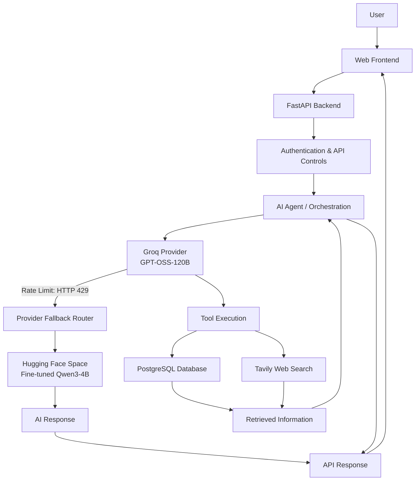
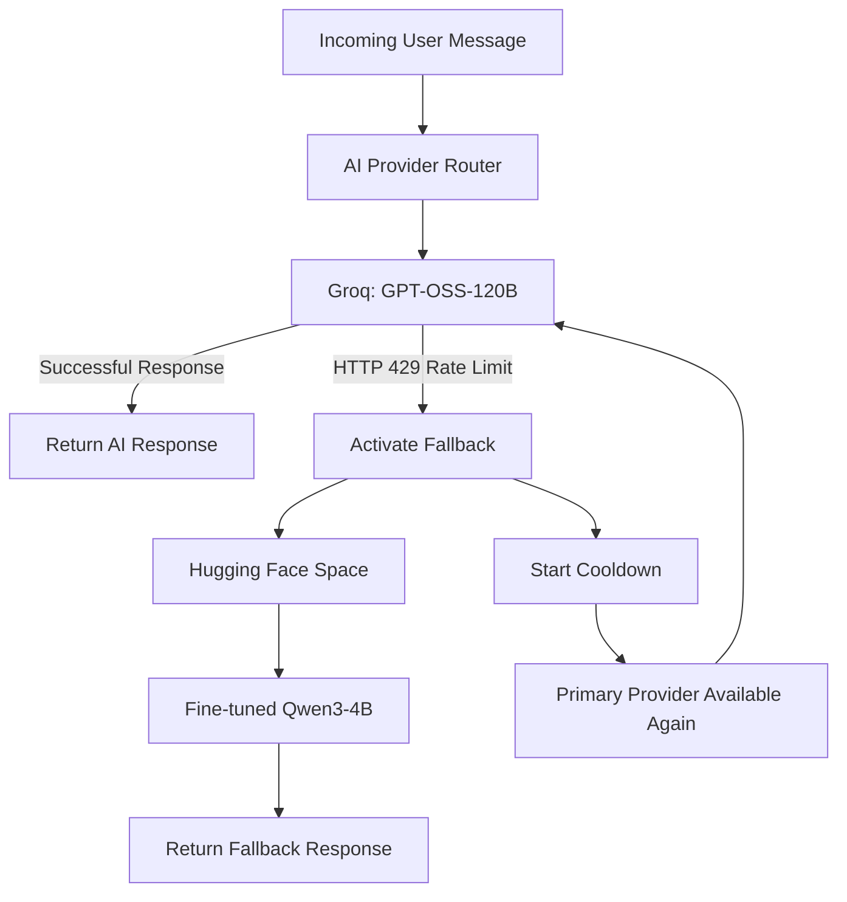

# 🚗 Car World AI
### An AI-Powered Automotive Discovery, Research & Recommendation Platform

<p align="center">
  <a href="https://car-world-1.onrender.com/"><strong>Live Demo</strong></a> •
  <a href="https://github.com/anshh-py/Car-World"><strong>GitHub Repository</strong></a> •
  <a href="https://huggingface.co/spaces/ansh9057/carworld-qwen3-inference"><strong>AI Model</strong></a>
</p>

<p align="center">
  
  
  
  
  
  
</p>

---

## Overview

**Car World AI** is an AI-powered automotive discovery and recommendation platform designed to make vehicle research more interactive and accessible.

Instead of relying entirely on traditional filters and manual comparisons, users can interact with an AI assistant using natural language to explore vehicles, compare specifications, discover relevant information, and receive recommendations.

The project combines **LLM-powered conversational AI, tool-based agent execution, a fine-tuned language model, web search integration, and a structured automotive database** into a unified application.

A key engineering aspect of the project is its multi-provider AI architecture: Groq powers the primary conversational experience, while a fine-tuned Qwen3-4B model hosted on Hugging Face provides a dedicated fallback when the primary provider encounters rate limits.

## Live Application

| Component | Link |
|---|---|
| Frontend | [Car World AI](https://car-world-1.onrender.com/) |
| Backend API | [FastAPI Backend](https://car-world-agoj.onrender.com) |
| API Health | [Health Endpoint](https://car-world-agoj.onrender.com/health) |
| GitHub | [Source Code](https://github.com/anshh-py/Car-World) |
| Hugging Face Space | [Qwen3 Inference](https://ansh9057-carworld-qwen3-inference.hf.space/) |
| Fine-tuned Model Adapter | [Qwen3-4B LoRA](https://huggingface.co/ansh9057/carworld-qwen3-4b-lora) |

---

## Key Features

### 🤖 AI-Powered Automotive Assistant
- Natural-language interaction for automotive queries.
- Context-aware conversational experience.
- AI-assisted vehicle discovery and recommendations.
- Tool-based execution for retrieving structured automotive information.
- Integrated web search for additional information.

### ⚖️ Vehicle Research & Comparison
- Explore vehicle specifications through conversational queries.
- Compare automotive information across different vehicles.
- Retrieve relevant details from a structured vehicle database.
- Support for automotive discovery without relying exclusively on manual navigation.

### 🧠 Multi-Provider AI Architecture
- Groq-hosted `openai/gpt-oss-120b` as the primary language model.
- Fine-tuned Qwen3-4B LoRA model as a fallback provider.
- Hugging Face Space for remote inference.
- Automatic fallback handling for primary-provider HTTP 429 rate-limit responses.
- Cooldown-based provider recovery, allowing the primary provider to resume after the cooldown period.

### 🔎 Integrated Information Retrieval
- Structured automotive database backed by PostgreSQL.
- Tool-based database queries.
- Tavily-powered web search integration.
- Backend-managed retrieval and response generation.

### 🔐 Authentication & API Management
- Optional Supabase authentication.
- Server-side access-token verification.
- Protected API functionality.
- Configurable CORS and request rate limiting.

---

## System Architecture

Car World AI follows a modular architecture that separates the frontend, API layer, AI orchestration, model providers, and data storage.



### Architecture Highlights

- **Frontend:** Provides the user-facing automotive discovery and conversational interface.
- **FastAPI:** Handles HTTP requests, authentication, API controls, and communication with the AI system.
- **AI Agent:** Coordinates language-model interaction and tool execution.
- **Provider Router:** Manages primary-provider errors, fallback selection, and cooldown-based recovery.
- **PostgreSQL:** Stores structured automotive information.
- **Hugging Face:** Hosts the fine-tuned Qwen3 inference service.
- **Tavily:** Supports external information retrieval through web search.

---

## AI Provider Routing

One of the central engineering components is the multi-provider routing system.

Rather than depending entirely on one model provider, the backend uses a primary-and-fallback strategy.



**Provider strategy:**

| Provider | Model | Responsibility |
|---|---|---|
| Primary | `openai/gpt-oss-120b` via Groq | Main conversational AI |
| Fallback | Fine-tuned Qwen3-4B LoRA | Alternative inference during primary-provider rate limits |
| Hosting | Hugging Face Spaces | Remote fallback model inference |

The routing logic handles provider selection and recovery, keeping model-provider management within the backend rather than exposing it to the frontend.

---

## Technology Stack

| Category | Technologies |
|---|---|
| Programming Language | Python |
| Backend Framework | FastAPI |
| Frontend | HTML, CSS, JavaScript |
| Primary LLM | GPT-OSS-120B via Groq |
| Fine-tuned Model | Qwen3-4B with LoRA |
| Model Hosting | Hugging Face Spaces |
| Model Integration | Gradio Client |
| Database | PostgreSQL |
| Authentication | Supabase |
| Web Search | Tavily |
| Database Migrations | Alembic |
| Testing | Pytest |
| Deployment | Render |
| Version Control | Git, GitHub |

---

## Fine-Tuned AI Model

Car World AI also integrates a fine-tuned Qwen3-4B model using a LoRA adapter.

The model is hosted separately through Hugging Face Spaces and accessed by the backend through the Gradio Client.

**Model resources:**

- [Hugging Face Space – Qwen3 Inference](https://huggingface.co/spaces/ansh9057/carworld-qwen3-inference)
- [Qwen3-4B LoRA Adapter](https://huggingface.co/ansh9057/carworld-qwen3-4b-lora)

This integration demonstrates experience working with fine-tuned language models, remote inference services, model-provider abstraction, and backend API integration.

---

## Backend API

The application exposes a REST API through FastAPI.

| Endpoint | Method | Purpose |
|---|---|---|
| `/health` | GET | Backend health check |
| `/api/v1/health` | GET | Health compatibility endpoint |
| `/api/chat` | POST | Conversational AI interaction |

### Example Chat Request

```json
{
  "message": "Compare two cars based on their specifications",
  "history": []
}
```

### Example API Usage

```python
import requests

url = "https://car-world-agoj.onrender.com/api/chat"

payload = {
    "message": "Recommend a car for city driving",
    "history": []
}

response = requests.post(url, json=payload, timeout=60)

print(response.json())
```

---

## Project Structure

The application is organized into separate frontend, backend, AI, and deployment components.

```text
Car-World/
│
├── backend/
│   ├── app/
│   │   ├── api/
│   │   ├── agents/
│   │   ├── services/
│   │   ├── providers/
│   │   ├── database/
│   │   └── main.py
│   │
│   ├── tests/
│   └── requirements.txt
│
├── apps/
│   └── Frontend application assets
│
├── n8n/
│   └── Automation workflows
│
├── app.py
├── .env.example
├── Dockerfile
└── README.md
```

---

## Getting Started

Follow these steps to run the application locally.

### 1. Clone the Repository

```bash
git clone https://github.com/anshh-py/Car-World.git
cd Car-World
```

### 2. Create a Virtual Environment

```bash
python -m venv .venv
```

Activate it:

**Windows**

```bash
.venv\Scripts\activate
```

**Linux / macOS**

```bash
source .venv/bin/activate
```

### 3. Install Dependencies

```bash
pip install -r backend/requirements.txt
```

### 4. Configure Environment Variables

Create a `.env` file using `.env.example` as a reference.

Configure the required credentials and connection details for the services you intend to run:

- Groq API key
- Hugging Face token and Space ID
- PostgreSQL connection
- Supabase credentials, if using authentication
- Tavily API key, if using web search

Never commit API keys, access tokens, passwords, or other secrets to GitHub.

### 5. Start the Backend

From the project root:

```bash
python -m uvicorn --app-dir backend app.main:app --reload --port 8000
```

Backend URL:

```text
http://127.0.0.1:8000
```

### 6. Start the Frontend

On Windows, use the provided frontend startup script:

```bash
start-frontend.cmd
```

The frontend can then be accessed at:

```text
http://127.0.0.1:5500
```

### 7. Run the Tests

```bash
cd backend
python -m pytest -q
```

---

## Deployment

The application uses a separated deployment architecture.

| Service | Platform | Responsibility |
|---|---|---|
| Frontend | Render | Web application |
| Backend | Render | FastAPI application |
| Database | PostgreSQL | Automotive data storage |
| Primary AI | Groq | Main LLM inference |
| Fallback AI | Hugging Face Spaces | Fine-tuned Qwen3 inference |

This separation allows the frontend, backend, database, and AI inference services to operate independently while communicating through defined interfaces.

---

## Engineering Highlights

The project brings together several practical software engineering concepts:

- Designing and integrating an LLM-powered application.
- Building a modular backend using FastAPI.
- Implementing tool-based AI agent execution.
- Integrating structured database retrieval with conversational AI.
- Working with fine-tuned language models and LoRA adapters.
- Building a multi-provider LLM routing and fallback mechanism.
- Connecting remote model inference through the Gradio Client.
- Integrating external web search.
- Implementing authentication and API security controls.
- Managing database migrations and automated tests.
- Deploying interconnected services using cloud platforms.

---

## Future Development

Potential areas for extending the platform include:

- More advanced automotive recommendation algorithms.
- Improved vehicle entity recognition and comparison.
- Expanded automotive datasets.
- Additional model-provider integrations.
- Enhanced evaluation of AI responses.
- Richer vehicle analytics and discovery interfaces.

---

**Connect:**
- GitHub: [@anshh-py](https://github.com/anshh-py)
- Project: [Car World AI](https://github.com/anshh-py/Car-World)

---

<p align="center">
  <strong>Car World AI — Bringing conversational AI to automotive discovery.</strong>
</p>
