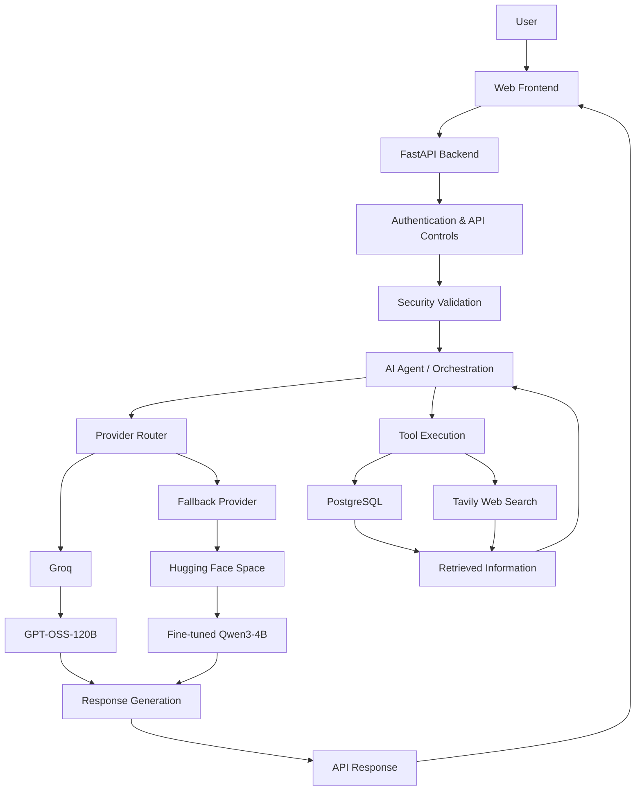
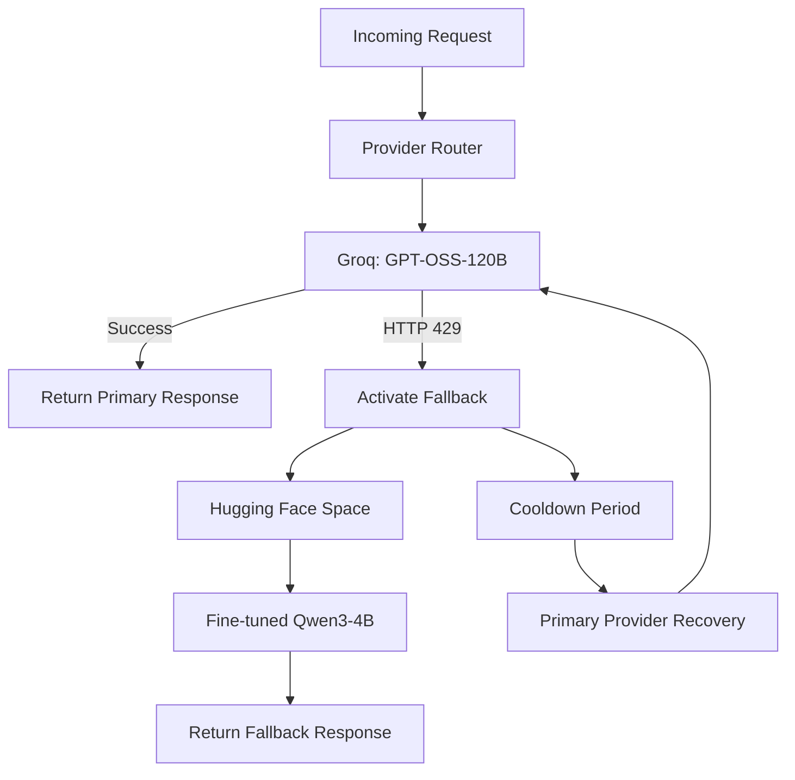
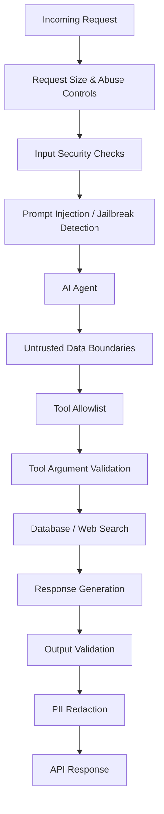

# 🚗 Car World AI

### An AI-Powered Automotive Research, Discovery & Recommendation Platform

\<p align="center">
&#x20; \<a href="[https://car-world-1.onrender.com/](https://car-world-1.onrender.com/)">\<strong>Live Demo\</strong>\</a> •
&#x20; \<a href="[https://github.com/anshh-py/Car-World](https://github.com/anshh-py/Car-World)">\<strong>GitHub Repository\</strong>\</a> •
&#x20; \<a href="[https://huggingface.co/spaces/ansh9057/carworld-qwen3-inference](https://huggingface.co/spaces/ansh9057/carworld-qwen3-inference)">\<strong>Qwen3 Inference\</strong>\</a> •
&#x20; \<a href="[https://huggingface.co/ansh9057/carworld-qwen3-4b-lora](https://huggingface.co/ansh9057/carworld-qwen3-4b-lora)">\<strong>Model Adapter\</strong>\</a>
\</p>

\<p align="center">
&#x20; \
&#x20; \
&#x20; \
&#x20; \
&#x20; \
&#x20; \
&#x20; \
\</p>

---

## Overview

**Car World AI** is an AI-powered automotive research and discovery platform that allows users to explore vehicles, compare specifications, and ask automotive questions through a conversational interface.

Instead of depending entirely on static filters and manual specification searches, users can interact with an AI assistant using natural language. The backend combines language models, tool-based information retrieval, a structured automotive database, and external web search to support automotive research.

The project also explores a practical engineering problem in LLM applications: **provider reliability**. Groq serves as the primary inference provider, while a separately hosted Qwen3-4B LoRA model provides a fallback when the primary provider encounters HTTP 429 rate limits.

Beyond the conversational layer, the project includes backend security controls, performance instrumentation, configurable usage and cost accounting, and optional semantic caching.

## Live Application

| Component                | Link                                                                                  |
| ------------------------ | ------------------------------------------------------------------------------------- |
| Frontend                 | [Car World AI](https://car-world-1.onrender.com/)                                     |
| Backend API              | [FastAPI Backend](https://car-world-agoj.onrender.com)                                |
| Health Check             | [API Health Endpoint](https://car-world-agoj.onrender.com/health)                     |
| Source Code              | [GitHub Repository](https://github.com/anshh-py/Car-World)                            |
| Qwen3 Inference          | [Hugging Face Space](https://huggingface.co/spaces/ansh9057/carworld-qwen3-inference) |
| Fine-tuned Model Adapter | [Qwen3-4B LoRA](https://huggingface.co/ansh9057/carworld-qwen3-4b-lora)               |

---

## Key Features

### 1. AI-Powered Automotive Assistant

- Natural-language automotive conversations.
- Context-aware conversation history.
- Automotive discovery and recommendation assistance.
- Tool-based execution for structured information retrieval.
- Integrated web search for additional information.
- Streaming responses for the conversational experience.

### 2. Multi-Provider LLM Architecture

- Groq-hosted `openai/gpt-oss-120b` as the primary model.
- Fine-tuned Qwen3-4B LoRA model as the fallback.
- Remote fallback inference through Hugging Face Spaces.
- Automatic fallback on primary-provider HTTP 429 rate limits.
- Cooldown-based recovery to the primary provider.
- Provider management handled on the backend.

### 3. Automotive Information Retrieval

- PostgreSQL-backed structured automotive information.
- Tool-based database queries.
- Tavily-powered external web search.
- Backend-managed retrieval and response generation.

### 4. Security Engineering

The backend includes multiple layers of application and AI-specific security controls:

- Prompt-injection and jailbreak detection.
- Explicit boundaries for untrusted input.
- Tool allowlisting and argument validation.
- Request-size protection.
- Output validation.
- Personally identifiable information (PII) redaction.
- Abuse-gating controls.
- Security evaluation utilities.

These controls are implemented in the backend rather than relying exclusively on the model to follow instructions.

### 5. Performance & Usage Instrumentation

The project includes instrumentation for understanding the cost and latency of AI interactions:

- Provider-level latency measurements.
- Total request and tool-execution timing.
- Agent initialization and cache-lookup timing.
- Provider usage and configurable cost accounting.
- Aggregate diagnostic logging.
- Prompt-token benchmark utility.

Token estimation uses a deterministic heuristic and is intended for diagnostics and benchmarking, not billing-grade token accounting.

### 6. Optional Semantic Caching

A privacy-conscious semantic cache is available for guest interactions.

- Disabled by default.
- Configurable through environment variables.
- TTL-based expiration.
- Bounded cache size.
- Similarity-threshold configuration.
- Designed to avoid caching authenticated users' private conversations.

Caching must be explicitly enabled through configuration.

---

## System Architecture

Car World AI separates the frontend, API layer, AI orchestration, provider routing, tools, and data storage.



### Architecture Components

| Component          | Responsibility                                         |
| ------------------ | ------------------------------------------------------ |
| Frontend           | Conversational automotive interface                    |
| FastAPI            | HTTP API, request handling and application integration |
| Security Layer     | Input validation, abuse controls and output checks     |
| AI Agent           | Coordinates model interaction and tool execution       |
| Provider Router    | Primary/fallback selection and recovery                |
| Groq               | Primary LLM inference                                  |
| Hugging Face Space | Remote fallback inference                              |
| PostgreSQL         | Structured automotive information                      |
| Tavily             | External web search                                    |
| Supabase           | Authentication integration                             |

---

## AI Provider Routing

A central design decision is to avoid making the application dependent on a single inference provider.

The backend uses a primary-and-fallback strategy.



| Provider | Model                          | Role                                             |
| -------- | ------------------------------ | ------------------------------------------------ |
| Primary  | `openai/gpt-oss-120b` via Groq | Main conversational inference                    |
| Fallback | Fine-tuned Qwen3-4B LoRA       | Alternative inference during primary rate limits |
| Hosting  | Hugging Face Spaces            | Remote fallback inference                        |

The routing layer keeps provider-specific handling in the backend. The frontend does not need to manage model-provider selection.

---

## Security Architecture

LLM applications introduce risks beyond conventional API security. User messages, retrieved content, and tool arguments can all influence model behavior.

Car World AI uses a layered approach to reduce these risks.



Security controls include:

- Detection of suspicious instruction patterns.
- Separation of untrusted content from trusted application instructions.
- Validation before tool execution.
- Output checks before returning responses.
- PII redaction and abuse controls.

These mechanisms are defense-in-depth controls. They reduce risk but do not guarantee that every possible prompt injection or malicious input will be detected.

---

## Performance & Observability

Performance work focuses on understanding where time and model usage are spent during an AI request.

The instrumentation tracks:

| Metric Area           | Purpose                                        |
| --------------------- | ---------------------------------------------- |
| Provider latency      | Measure inference-provider response time       |
| Total request latency | Understand end-to-end request duration         |
| Tool execution        | Identify retrieval and tool bottlenecks        |
| Agent initialization  | Track agent setup overhead                     |
| Cache lookup          | Observe optional semantic-cache activity       |
| Usage accounting      | Estimate provider usage and configurable costs |

### Additional Utilities

| Utility          | Purpose                                                                  |
| ---------------- | ------------------------------------------------------------------------ |
| Prompt benchmark | Reproducible prompt-token comparison                                     |
| Token estimator  | Deterministic heuristic token estimation                                 |
| Batch runner     | Offline batch execution with bounded concurrency, throttling and retries |
| Diagnostics      | Aggregate performance and usage logging                                  |
| Semantic cache   | Optional guest-only response caching                                     |

The batch runner is a standalone utility; it should not be interpreted as an active part of the live conversational request pipeline.

The token estimator is heuristic-based and should not be used as an exact representation of provider billing.

---

## Technology Stack

| Category            | Technologies          |
| ------------------- | --------------------- |
| Language            | Python                |
| Backend             | FastAPI               |
| Frontend            | HTML, CSS, JavaScript |
| Primary LLM         | GPT-OSS-120B via Groq |
| Fallback Model      | Qwen3-4B with LoRA    |
| Model Hosting       | Hugging Face Spaces   |
| Model Integration   | Gradio Client         |
| Database            | PostgreSQL            |
| Authentication      | Supabase              |
| Web Search          | Tavily                |
| Database Migrations | Alembic               |
| Testing             | Pytest                |
| Deployment          | Render                |
| Version Control     | Git, GitHub           |

---

## Fine-Tuned Model Integration

Car World AI integrates a Qwen3-4B model with a LoRA adapter as its secondary inference provider.

The inference service is hosted separately on Hugging Face Spaces and accessed by the backend using the Gradio Client.

**Model resources**

- [Qwen3 Inference Space](https://huggingface.co/spaces/ansh9057/carworld-qwen3-inference)
- [Qwen3-4B LoRA Adapter](https://huggingface.co/ansh9057/carworld-qwen3-4b-lora)

This integration demonstrates experience with:

- Fine-tuned model integration.
- LoRA adapter-based model workflows.
- Remote model inference.
- Provider abstraction.
- Fallback handling between independent inference services.

---

## Backend API

The application exposes a REST API through FastAPI.

| Endpoint         | Method | Purpose                       |
| ---------------- | ------ | ----------------------------- |
| `/health`        | GET    | Backend health check          |
| `/api/v1/health` | GET    | Health compatibility endpoint |
| `/api/chat`      | POST   | Conversational AI interaction |

### Example Request

```json
{
  "message": "Compare two cars based on their specifications",
  "history": []
}
```

### Example Python Client

```python
import requests

url = "https://car-world-agoj.onrender.com/api/chat"

payload = {
    "message": "Recommend a car for city driving",
    "history": []
}

response = requests.post(
    url,
    json=payload,
    timeout=60
)

response.raise_for_status()
print(response.json())
```

---

## Project Structure

The repository separates the backend application, frontend, tests, and supporting utilities.

```text
Car-World/
│
├── backend/
│   ├── app/
│   │   ├── api/
│   │   ├── agents/
│   │   ├── services/
│   │   ├── providers/
│   │   ├── database/
│   │   ├── core/
│   │   └── main.py
│   │
│   ├── tests/
│   ├── scripts/
│   ├── app/
│   │   └── modules/
│   │       └── chat/
│   ├── requirements.txt
│   └── test_live_qwen_fallback.py
│
├── docs/
│   ├── OPTIMIZATION_REPORT.md
│   └── DEPLOYMENT.md
│
├── apps/
│   └── Frontend application assets
│
├── app.py
├── .env.example
├── Dockerfile
└── README.md
```

*Note: This is a high-level structural overview, not an exhaustive listing of every repository file.*

---

## Getting Started

### 1. Clone the Repository

```bash
git clone https://github.com/anshh-py/Car-World.git
cd Car-World
```

### 2. Create a Virtual Environment

```bash
python -m venv .venv
```

Activate it:

**Windows**

```bash
.venv\Scripts\activate
```

**Linux / macOS**

```bash
source .venv/bin/activate
```

### 3. Install Dependencies

```bash
pip install -r backend/requirements.txt
```

### 4. Configure Environment Variables

Create a `.env` file using `.env.example` as the reference.

Configure the credentials and connection details required by the services you intend to use.

The project configuration includes integrations for:

- Groq API.
- Hugging Face inference.
- PostgreSQL.
- Supabase authentication.
- Tavily web search.

Optional performance configuration includes:

- `SEMANTIC_CACHE_ENABLED`
- `SEMANTIC_CACHE_TTL_SECONDS`
- `SEMANTIC_CACHE_MAX_ENTRIES`
- `SEMANTIC_CACHE_SIMILARITY_THRESHOLD`
- `GROQ_*_PRICE_PER_1M`
- `QWEN3_*_PRICE_PER_1M`

Semantic caching is disabled by default.

Refer to `.env.example` and `docs/DEPLOYMENT.md` for the actual configuration details.

**Never commit API keys, passwords, access tokens, or other secrets to GitHub.**

### 5. Start the Backend

From the repository root:

```bash
python -m uvicorn --app-dir backend app.main:app --reload --port 8000
```

Backend:

```text
http://127.0.0.1:8000
```

### 6. Start the Frontend

On Windows:

```bash
start-frontend.cmd
```

Frontend:

```text
http://127.0.0.1:5500
```

### 7. Run Tests

```bash
cd backend
python -m pytest -q
```

For the optional live fallback-provider verification:

```bash
python test_live_qwen_fallback.py
```

This interactive verification requires the relevant Hugging Face credentials and a reachable inference service.

---

## Deployment

Car World AI uses independently hosted application and inference components.

| Service            | Platform            | Responsibility          |
| ------------------ | ------------------- | ----------------------- |
| Frontend           | Render              | User-facing application |
| Backend            | Render              | FastAPI application     |
| Database           | PostgreSQL          | Structured data storage |
| Primary Inference  | Groq                | Main LLM inference      |
| Fallback Inference | Hugging Face Spaces | Qwen3 model inference   |

### Deployment Documentation

Refer to:

- [`docs/DEPLOYMENT.md`](docs/DEPLOYMENT.md)
- [`docs/OPTIMIZATION_REPORT.md`](docs/OPTIMIZATION_REPORT.md)

The optimization report documents the performance and security implementation in greater detail.

---

## Engineering Highlights

This project demonstrates practical experience across several areas of applied AI and backend engineering:

- Building an LLM-powered automotive application.
- Designing a modular FastAPI backend.
- Implementing tool-based AI agent execution.
- Integrating structured database retrieval with conversational AI.
- Integrating a fine-tuned Qwen3 model using LoRA.
- Implementing multi-provider LLM routing.
- Handling primary-provider rate limits and fallback recovery.
- Integrating remote inference through the Gradio Client.
- Implementing prompt-injection and jailbreak security checks.
- Validating tool names and arguments.
- Adding output validation and PII redaction.
- Instrumenting provider, tool, and request latency.
- Implementing configurable usage and cost accounting.
- Building an optional privacy-conscious semantic cache.
- Writing automated security and performance regression tests.
- Deploying interconnected services using cloud platforms.

---

## Known Scope & Limitations

The project has deliberate boundaries that are important when evaluating its implementation:

- The primary model and fallback model are independently hosted services.
- Fallback routing is designed around primary-provider HTTP 429 rate limits; it is not a guarantee of uninterrupted availability for every possible provider failure.
- Semantic caching is optional and disabled by default.
- Token estimation is heuristic-based, not billing-grade.
- The batch runner is a standalone offline utility, not part of the live chat pipeline.
- Security checks provide defense in depth, not a guarantee against all attacks.
- Actual model quality and response accuracy depend on the underlying models and retrieved information.

---

## Future Development

Potential areas for further development include:

- More advanced automotive recommendation algorithms.
- Improved vehicle entity recognition and comparison.
- Expanded and regularly updated automotive datasets.
- Additional model-provider integrations.
- More extensive AI response evaluation.
- Richer vehicle analytics and discovery interfaces.
- Further optimization of inference latency and operating costs.

---

## Connect

- **GitHub:** [@anshh-py](https://github.com/anshh-py)
- **Project Repository:** [Car World AI](https://github.com/anshh-py/Car-World)

\<p align="center">   \<strong>Car World AI — Bringing conversational AI to automotive discovery.\</strong> \</p>
